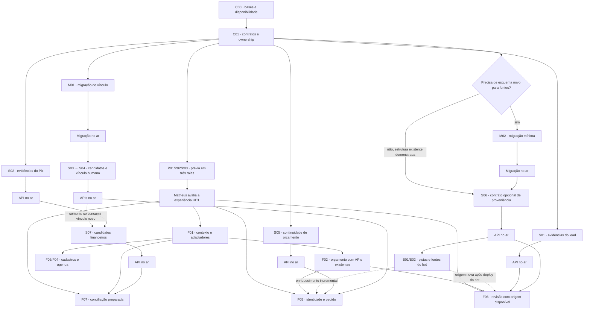

# Mapa de implementação orquestrada — Verly HITL

16/10/2026 · status: planejamento concluído; cartões de implementação ainda não disparados.

Base: [sweep de dados e inputs](AUDITORIA_PREFILL_HITL_2026-10-15.md), [decisões](DECISOES.md) e prévia local `26c74fc`. Este mapa rege a nova frente de preenchimento assistido; não reabre D9/D10/D11 nem repete cartões já mergeados do plano anterior. Achados de identidade, proveniência e Pix revisados com GPT Sol.

## Resultado esperado

Ao abrir uma conversa, o dono vê contato, peças, medidas, endereço e valores já preparados, com origem e pendências claras. Confere ou corrige; digita apenas o que falta. Orçamento, cliente, pedido, agenda e financeiro mantêm os IDs de contexto ao navegar.

Separar cinco estados na apresentação: **cadastro existente**, **extraído para conferir**, **padrão do sistema**, **calculado**, **confirmado pela pessoa**. Campo presente sem origem comprovada não ganha rótulo de confirmação. Nome de perfil, remetente, pagador, recebedor e cliente comercial permanecem papéis distintos.

## Regras de execução

- Nunca merge/deploy/escrita em produção pelo agente. Matheus revisa e mergeia. PR de ERP/service contra `prod`. Branch de destino do bot será confirmada em C00; a fonte auditada foi `origin/dev`, não inventar `prod` para esse repo.
- UI dependente de endpoint novo só abre PR depois de endpoint mergeado **e comprovadamente no ar**, sem flags de build. Bot consumidor de contrato novo segue a mesma sequência. Merge/pipeline em andamento não bastam.
- Migração isolada antes do consumidor service. Após merge feito pelo Matheus, acompanhar CI e provar digest/commit servido antes de abrir PR consumidor. Não consumir coluna apenas porque Flyway permite out-of-order.
- APIs existentes: respostas aditivas, novos campos opcionais; preservar o bot e os clientes antigos. Metadados novos ausentes nos registros legados significam origem desconhecida.
- G2 da nova experiência de revisão antecede UI de produção. A prévia sintética pode avançar antes dos novos endpoints, com as limitações de contrato visíveis; seus mocks/bootstrap não vão para produção.
- D10: não repropor erro genérico no backend; UI usa `friendlyError` sem ler `message`, inclusive em400/409. Conflitos necessários à escolha humana usam DTO estruturado, não texto de exception.
- Não adicionar frete, acabamento, notas de parceiro, alias de cliente ou condição de pagamento como campos persistidos apenas porque existem no desenho. Não oferecer Laminado como categoria já suportada. Usar os contratos reais de vidro/PVC/alumínio.
- Preservar checkouts principais do Matheus e mudanças locais. Worktree e branch isolados por cartão de produção. Não copiar `node_modules` entre bases incompatíveis.
- Dados sintéticos em testes/prints. Nenhuma coleta de dados de produção ou envio de mensagens implícitos. Amostragem real fica fora desta execução até autorização específica.

## Equipe e limite de concorrência

| Papel | Modelo | Responsabilidade |
|---|---|---|
| Orquestrador | sessão principal | fecha contratos, distribui cartões, revisa cada diff e evidência, integra e apresenta PRs ao Matheus |
| Raia A — interface | gpt-6-luna | revisão preparada, contexto entre abas, cadastros e agenda; um cartão por vez |
| Raia B — service | gpt-6-luna | endpoints, migrações e compatibilidade; ownership explícito de arquivos |
| Raia C — bot / verificação | gpt-6-luna | produtores opcionais e proveniência; quando o bot aguarda deploy, revisa texto, ícones, acessibilidade e contratos |
| Guia sob demanda | gpt-6-sol | segunda revisão de identidade, dinheiro, estado Pix, migração e achado controverso |

**Máximo de quatro agentes ativos incluindo o orquestrador.** Até três executores baratos em paralelo. Para consultar o Guia, aguardar/liberar uma vaga; não colocar o quinto agente em execução. Nas ondas de prévia, as três raias podem trabalhar em grupos de telas diferentes; a raia C não escreve bot enquanto revisa UI.

Escalação: `ESCALAR: achado / impacto / opções / recomendação / arquivos`. O executor não amplia escopo nem muda semântica para destravar a própria tarefa. Terceira rodada de correção ou diff de produção acima de cerca de500 linhas exige refatiamento/revisão do orquestrador; não mascarar tamanho com arquivos compactados em uma linha.

## Dependências principais

O diagrama mostra barreiras de publicação, não uma obrigação de esperar todo o backend para melhorar a interface. F02/F03/F04 usam contratos já existentes e podem ser entregues antes da revisão enriquecida. S01/S02/S05 podem avançar em paralelo à avaliação da prévia. IDs abaixo identificam cartões, **não números de PR**.

## Onda 0 — preparar cartões executáveis

| ID | Responsável | Entrega | Aceite / dependência |
|---|---|---|---|
| C00 | orquestrador | Atualizar refs e PRs abertos, ler handoffs/AGENTS aplicáveis, congelar SHAs, conferir deploys e evitar duplicar trabalho de outras frentes. Confirmar base/CI do bot. | Registrar situação atual, worktrees e testes disponíveis. A prova de15/10 é histórica: service`2aa53c0`, run38811271508; bot`8679727`, run38788642328. Não assumir que são os topos atuais. |
| C01 | orquestrador + Guia | Especificação de campos/estados, matriz input→fonte→ação, exemplos sintéticos e contrato dos novos endpoints. Definir armazenamento mínimo de vínculo/proveniência/decisão e revisões de dados. | Cada atributo tem unidade, nulabilidade, origem possível, fallback legado e decisão humana. Decidir se M02 é necessário; não criar migração por hábito. Fechar arquivos de cada executor antes de disparar. |

Decisões técnicas obrigatórias em C01:

1. `LeadDTO.data` é **string JSON**; parsing defensivo e estrutura desconhecida não podem quebrar a tela.
2. Orçamento calculado usa `POST /quotes/from-lead`, que grava `customerId=null`. Guardar um ID no estado do browser não muda essa regra.
3. `convertedCustomerId` não será reaproveitado como vínculo genérico. Hoje `markWon` pode deixar o lead `CONVERTED` com esse campo nulo e visível; a conversão para cadastro define o campo, arquiva e faz backfill dos quotes. O vínculo humano com cliente existente terá contrato próprio, sem reclassificar a venda/arquivar por efeito colateral.
4. Confirmação terá referência à versão/contexto revisado. Se itens, vínculo ou valores relevantes mudarem durante a revisão, pedir nova conferência; não gravar decisão sobre uma extração diferente. C01 escolhe mecanismo compatível e testes de concorrência necessários, sem impor versão nova aos clientes antigos.
5. Selecionar candidato não confirma alias/chave globalmente, não funde clientes e não autoriza pagamento. Pistas do bot são evidência, não vínculo humano.
6. APIs novas: nomes finais, payloads e erros estruturados são fechados nesse cartão. Os nomes de cartões deste plano não alegam que endpoints já existem.

## Onda 1 — nova prévia para avaliar a redução de digitação

Três agentes baratos em paralelo, **na branch descartável**, com arquivos exclusivos. Orquestrador controla entrypoint, CSS compartilhado, dados e integração. Se houver estado compartilhado, sua interface é combinada antes de escrever; ninguém redefine fixtures do mesmo cliente de forma independente.

| ID | Raia | Trabalho | Aceite |
|---|---|---|---|
| P01 | A | Leads e revisão de orçamento: ficha pronta, peças detectadas, origem agregada disponível, custo calculado de exemplo, Corrigir e pendências. Novo orçamento recebe contexto quando existe. | Caminho completo sem redigitar nome/telefone/medidas já presentes; ausentes continuam ausentes; quantidade/alternativas preservadas; criação avulsa ainda funciona. |
| P02 | B | Clientes/parceiros/produtos/pedidos/agenda: dados já conhecidos aparecem como resumo; remover requisitos sem DTO; conservar contexto ao abrir outra aba. | Telefone opcional onde API permite; sem condição50%, custo30%, acessóriozero ou horário arbitrário como fato; agenda não muda produção/medição. |
| P03 | C | Financeiro: recebido medido preparado; pagador/remetente/recebedor/cliente separados; candidatos, conflito, desconhecido e confirmação específica. | Evidências inexistentes na API não são apresentadas como integração pronta; casos marido paga/funcionário encaminha/terceiro/transferência própria. Sem auto-postagem. |

**G2:** entregar uma única prévia navegável desktop/celular, roteiro de tarefas e registro de heurísticas. A aprovação vale para os fluxos vistos, sem presumir aprovação de contratos novos, transferências contábeis ou dados reais. Feedback do Matheus é incorporado antes da UI de produção correspondente.

## Onda 2 — primeira entrega usando APIs existentes

Depois de G2, quatro cartões sequenciais onde há arquivos compartilhados; cadastros e agenda podem correr em paralelo após F01.

| ID | Raia | Escopo / ownership inicial | Aceite verificável |
|---|---|---|---|
| F01 | A | Adaptadores tipados de contexto e navegação por IDs; carregar lead/cliente/quote/pedido/parceiro existentes. Um módulo pequeno para traduzir DTOs em apresentação da revisão. | URL/reload mantém identidade selecionada; cliente→pedidos e parceiro→financeiro conservam filtro. Não casar por nome. Ausente≠zero; origem desconhecida não vira confirmada. Teste de unidade de tradução e navegação com registros conflitantes. |
| F02 | A, após F01 | Revisão de lead/Novo orçamento em componentes reais; reutilizar cálculo e `quotes/from-lead`. | Sem redigitação dos itens conhecidos; texto/áudio/foto são sugestão; centímetros×m² corretos para vidro/PVC; preço da API, inclusive indisponível e resposta atrasada; salvar recalcula. Orçar sem CPF continua funcionando. Pedido só converte com vínculo suportado. |
| F03 | B ou A livre, após F01 | Cadastros e catálogo: contato/endereço existentes, campos opcionais e tipos reais; custos atrás de Detalhar, sem persistência fictícia. Dividir em PRs por fluxo se ultrapassar limite de revisão. | Editar conserva atributos existentes; não enviar propriedades inventadas como se fossem suportadas; usuário/senha/papel ficam no fluxo administrativo. |
| F04 | C ou A livre, após F01 | Visita técnica e instalação usando endpoints existentes; carregar endereço/agenda/responsável; perguntar apenas compromisso ausente. | Visita≠instalação; dia inferido não inventa hora; reagendar preserva etapa comercial/produção; ausência de endereço confirmado aparece explicitamente. |

Essa onda não promete a imagem pré-bridge nem evidência por campo. Pode mostrar `description`, `data` e itens já retornados, com limites claros. F02 não depende de esperar todo o programa de Pix.

## Onda 3 — service aditivo, identidade e evidências

Pode começar após C01, antes de G2, pois não muda a UI. A raia B escreve service; uma segunda raia só entra quando houver arquivos totalmente independentes. Nada de duas pessoas alterando `LeadService`/`QuoteService` ao mesmo tempo.

| ID | Entrega | Depende de | Aceite / prova requerida |
|---|---|---|---|
| S01 | Leitura de contexto/evidências do lead: dados existentes, transcrição/sinais, localização e fontes recuperáveis, sem fingir vínculo por campo. | C01 | API autenticada, resposta limitada e aditiva; fonte ausente/registro legado bem representado; não despejar raw_payload ou conversas de outro contato. Teste com schema bot ausente/incompleto conforme ambiente suportado. |
| S02 | Leitura de evidência do Pix e mídia original recebida pelo bot antes do bridge; papéis disponíveis, origem, recência e limites da extração. | C01 | Teste receipt sem ledger, mídia ausente, MIME inválido, fonte divergente e autorização. Não confundir com `/ledgers/{id}/receipt`. Falta de OCR não vira confirmação. |
| M01 | Migração aditiva para vínculo humano lead↔cliente existente e auditoria mínima da decisão, conforme C01. | C01 | Unicidade/constraints definidas; histórico e legado preservados; SQL não altera lead status/convertedCustomerId nem clientes existentes. PR **só migração**, teste junto ao código de produção SQL. |
| S03 | Resolver candidatos de cliente, incluindo pista de `contacts.verly_customer_id` quando recuperável, cadastro e telefones normalizados. | M01 **no ar**, se lê o novo vínculo | Retorna todos os candidatos relevantes e motivo, conflito/ambiguidade explícitos. Nunca usa primeiro sufixo como decisão. Nome/valor isolados são pista fraca. Não modifica cadastro ao consultar. Ausência da pista de cliente do bot não reprova os casos legados; candidato humano precisa funcionar independentemente de B01. |
| S04 | Registrar/rever vínculo humano com cliente existente; integrar cliente confirmado à criação/resolução de quote/order, sem mudar significado dos campos legados. | S03; M01 no ar | Não cria outro cliente; valida existência, conflito e revisão desatualizada; backfill só de quotes sem cliente e do contexto permitido. Não sobrescreve quote de outro cliente ou ledger postado. Testes WON visível sem cadastro, convertido/arquivado, cliente já ligado, dois candidatos e concorrência. Guia revisa. |
| S05 | Consulta de propostas por lead e leitura/edição que preserva leadId, customerId, desconto e produtos; controlar valor final negociado no round-trip. | C01; serializado com S04 se compartilha arquivos | GET→editar→GET mantém vínculos/valores não editados; compatibilidade do bot preservada. Não reinterpretar override como frete. Se exigir dado persistido novo, migração precede consumidor. |
| M02 | Migração opcional para proveniência/revisão que não caiba no armazenamento atual, **somente se C01 demonstrar necessidade**. | C01 | Contrato de retenção/legado definido; não misturar com backfill de identidades. Se dispensada, registrar qual estrutura existente suporta o contrato e pular este cartão explicitamente. |
| S06 | Ingestão/leitura opcional de fontes por item/campo, pista de cliente e revisão; preservar comportamento sem metadados. | M02 no ar quando necessária; C01 | IDs de fonte validados contra o contexto correto; tolera versões antigas; distingue modelo/default de afirmação humana. Bot antigo continua operando. Origem legacy desconhecida não é fabricada. Serializar com S04 se toca o mesmo ingest de lead. |
| S07 | Candidatos financeiros por papel e contexto: cliente/pedido/contraparte e divergências, reutilizando resolução de parceiros. Persistência da decisão/rejeição usa auditoria existente quando suficiente; C01 define complemento mínimo se necessário. | S02 no ar; S03/S04 somente para subfluxo que consuma o novo vínculo; migração de auditoria antes do consumidor, caso necessária | Remetente diferente de pagador; destinatário loja→entrada; comprovante de terceiro; saída para prestador; pedido de outro cliente; mesmo valor em vários pedidos; identidade conflitante. Candidatura é leitura, não bridge/post. |

**G3 por cartão**, não um gate único no fim: Matheus mergeia, CI conclui e o orquestrador registra SHA/digest servido antes do PR que consome aquela alteração. S01/S02 podem publicar evidência existente antes de B02 produzir metadados melhores.

## Onda 4 — bot publica o contexto que hoje se perde

Raia C. Não mudar classificador/prompt, estratégia de preço ou confirmação de pagamento nesse lote.

| ID | Entrega | Depende de | Aceite |
|---|---|---|---|
| B01 | Publicar pista do cliente já conhecido no contato, usando o contrato opcional de S06; preservar IDs estáveis e repetição idempotente. | S06 mergeado **e no ar**; contrato S03/S04 fechado | Cliente ausente/múltiplo/invalidado não vira vínculo. Não envia pista como `convertedCustomerId` nem prova de comprador. Bot sem pista e service compatível continuam funcionando. |
| B02 | Preservar IDs de extrações/itens e origem disponível antes dos defaults; transmitir metadados opcionais e referências válidas. | S06 no ar | Não alterar quantidades/medidas/preços no cartão de metadados. Cobrir texto, voz, foto, ausência, consolidação e IDs alucinados/fora da sessão. Origem modelo não afirma trecho literal sem evidência; aliases/chaves não viram cadastro global automaticamente. |

Após publicação pelo Matheus, registrar também o deploy do bot. Dados antigos continuam com a proveniência que realmente existe; não rodar reprocessamento/backfill de mensagens reais como efeito implícito desses PRs.

## Onda 5 — interface enriquecida sobre contratos publicados

| ID | Raia | Entrega | Dependências antes de abrir PR |
|---|---|---|---|
| F05 | A | Selecionar cliente existente com candidatos e gravar vínculo; quote→order sem refazer cadastro. | G2, F01/F02, S03/S04/S05 no ar. B01 é enriquecimento incremental: sem ele, seleção humana de candidato existente já funciona. O teste da pista nova depende do deploy do bot. |
| F06 | A ou B livre | Origem/trecho/recência por item quando disponíveis; Corrigir e confirmação do conjunto sobre a versão revisada; endereço parcial e alternativas. | G2, F01/F02, S01/S06 no ar; B02 não bloqueia o caso legado. Nova origem é validada ponta a ponta após o deploy do bot. Sem metadados, mostra contexto agregado/ausência explicitamente. |
| F07 | A, com Guia | Conciliação preparada por evidências e candidatos: medir→conferir destino→bridge PENDING→post humano com desfazer conforme contrato existente. | G2, F01, S02/S07 no ar; S03/S04 somente no subfluxo que depende do vínculo novo. Reutilizar serviços tipados, `money`, `friendlyError`, `deferredAction`. |

F07 precisa manter: bloqueio do não medido; duplicata reconhecida com nota; idempotência por recibo/reuso do ledger; cliente/pedido compatíveis; correção não sobrescreve lançamento postado; só `post` confirma e afeta o pedido. Transferência entre contas próprias **não** vira receita, despesa ou dispensa automática. Contabilização própria aguarda decisão/contrato do dono, sem bloquear os demais casos suportados.

## Ordem de PRs e resolução de conflitos

1. Captura local da prévia P01–P03; nada dos mocks vai ao PR de produto.
2. Primeiro lote para revisão: **F01 → F02**, após G2. F03/F04 depois de F01, em lote seguinte se houver colisão. Cada PR parte do `prod` atualizado que contém sua dependência.
3. Backend independente: **S01**, **S02**, **M01** podem ser preparados separadamente; root revisa integrações antes de publicar. **M01 merge/deploy → S03 → S04**. S05 vem após S04 quando ambos tocarem QuoteService.
4. Proveniência: **M02 se necessária → S06 → F06**; **S06 → B01/B02** enriquece depois os registros novos, com deploy próprio. Não bloquear F06 legado por ausência do produtor novo. B01 e B02 serializados se ambos alteram `lead_synthesis.py`/`verly_client.py`.
5. Identidade na UI: **S03/S04/S05 no ar → F05**. Financeiro: **S02 no ar → S07 → F07**; consumir vínculo novo de identidade exige S03/S04 no ar no subfluxo correspondente.
6. Limitar o lote apresentado ao Matheus a até três PRs prontos, com ordem e dependência exatas. Os números reais entram no registro de execução quando existirem.

Mapa de colisões obrigatório:

| Área | Cartões que devem ser serializados ou refatiados |
|---|---|
| `LeadQuote.vue`, `NewQuote.vue`, navegação e adapters | F01→F02; depois F05/F06 sobre a base atualizada |
| Cadastros/layout/ícones compartilhados | F03 não altera navbar/primitivos em paralelo ao orçamento; mudanças comuns são do orquestrador |
| `LeadService`, `LeadDTO`, entidades/mapper de itens | S03/S04/S06: ownership por função/arquivo antes de abrir segunda raia |
| `QuoteService`, `QuoteController`, DTOs de quote | S04→S05; revisão de F02 não deve assumir DTO de S05 antes do deploy |
| Pix services/query/DTO | S02→S07; F07 só lê contrato publicado |
| Bot síntese/client/payload | B01→B02 se mesmos arquivos; sem refatoração mecânica paralela |
| Migrações | Orquestrador reserva versão após atualizar origin/prod; não confiar em número previsto no plano |

Worktree: `~/Documents/repositories/verly/wt/orq/HITL-<ID>`, branch `feat/hitl-<id>-<assunto>` a partir da base permitida. Executor entrega commit local e evidências. Orquestrador lê o diff; publicação em draft; revisão pelo GitHub; correções na mesma raia; ready somente após gates. Não criar PR contra branch de dependência para contornar a obrigação de base `prod`.

## Verificação e encerramento de cartão

- **ERP produção:** `npx vue-tsc -b`, `npm run test:run`, `npm run build`; inspeção393/768/1440 com fixtures sintéticas, foco/teclado, rótulos, mínimo44px e texto15px (13px só na barra inferior aprovada). Confirmar dinheiro HALF_UP e resposta atrasada do cálculo sem sobrescrever a peça atual.
- **Service:** testes significativos de integração/contrato e `mvn -B -q test`, Postgres/Testcontainers/Flyway; Spotless conforme repo. Sem PR só de teste.
- **Bot:** descobrir comando/venv/CI vigente em C00; testes focados e suíte do pipeline com banco sintético quando exigido. Não apontar testes ao banco real. Não declarar que defaults de configuração do source são flags ativas do ambiente.
- **Prévia:** inspeção visual e de fluxos, typecheck/build adequados; sem criar suíte unitária que espelhe o mock.
- Serializar gates ERP quando worktrees compartilham dependências/cache. Não mais de três Maven simultâneos; preferir um conjunto pesado por vez se houver pressão de memória.
- Revisão de ícones e heurísticas em cada fluxo: significado consistente e rótulo; estado sem depender só de cor; botão desabilitado com motivo; ausência sem valor inventado; Corrigir preserva os demais campos; contexto não se perde ao navegar.

Cenários de aceite de ponta a ponta:

1. Lead completo→revisar→orçar sem redigitar contato ou itens e sem CPF obrigatório nessa etapa.
2. Lead parcial→somente a lacuna é solicitada; cor/folhas default não aparecem como afirmadas.
3. Duas alternativas de peça→escolha explícita, sem somar ambas como compra.
4. Cliente existente conhecido pelo bot→candidato→vínculo humano→pedido, sem criar duplicata/arquivar por engano.
5. Nome de perfil/apelido diferente do cadastro e dois clientes com telefone parecido→ambiguidade visível.
6. Proposta revisada enquanto nova síntese chega→sem gravar decisão sobre dados diferentes sem reconferir.
7. Endereço parcial/pin GPS e endereço anterior de outra obra→sem misturar com instalação atual.
8. Visita mencionada só pelo dia→pedir horário; reagendar instalação→preservar andamento.
9. Pagador terceiro/funcionário encaminhando/recibo de referência→papéis separados e sem contabilização automática.
10. Pix incompleto, duplicado ou já postado→guardas existentes preservadas; confirmação/desfazer afetam fila e saldo corretamente.

Cada entrega registra commit, dependências, testes, capturas sintéticas e limitações. Não prometer percentual de redução de digitação com base nas fixtures. Métrica inicial pode contar campos já preenchidos, lacunas e correções nos cenários sintéticos; métricas em registros reais exigem autorização própria.

## Primeiro disparo quando este mapa entrar em execução

**C00 + C01**, depois **P01/P02/P03 em três raias baratas**; root integra uma nova prévia para o Matheus avaliar. Em paralelo à avaliação, somente backend aditivo com contrato fechado. A implementação de produção começa por **F01/F02**, sem esperar as melhorias futuras de OCR/identidade/Pix, e avança por fluxo conforme os gates acima.
